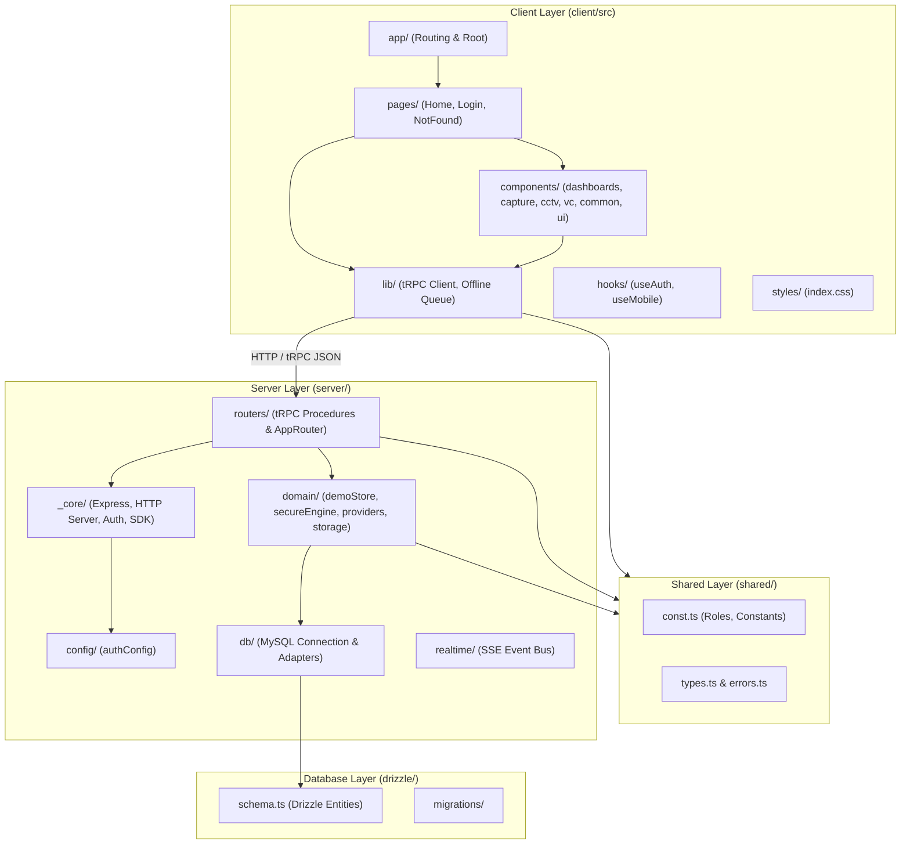

# Securesight Architecture & Layer Boundaries

## Overview
Securesight (DoSJE Nigrani 2.0 Grid) is structured into distinct, strict layers. Communication flows top-down from the React client through tRPC procedure routers into domain services, ending at the persistence layer (MySQL / in-memory fallback).

---

## Directory Responsibilities & Boundary Guidelines

| Directory | What Belongs Here | What MUST NOT Go Here |
| :--- | :--- | :--- |
| `client/src/app/` | Root mount, router definitions, protected route wrappers | Business logic, direct DB queries, inline UI components |
| `client/src/pages/` | Top-level view routes (Home, Login, NotFound) | Shared primitive UI components, server code |
| `client/src/components/` | Modular UI components grouped by feature (`dashboards/`, `capture/`, `cctv/`, `vc/`, `common/`, `ui/`) | Direct database operations, server endpoints |
| `client/src/lib/` | tRPC client setup, offline queue manager, client utilities | React visual JSX components, server-only code |
| `client/src/hooks/` | Reusable React hooks (`useAuth`, `useMobile`, `useComposition`) | Direct DOM manipulation, backend business logic |
| `client/src/styles/` | Global CSS stylesheets, design tokens, color palette rules | JavaScript code, component templates |
| `server/_core/` | System infrastructure, Express setup, OAuth callbacks, Vite dev middleware | Feature-specific business rules, custom domain calculations |
| `server/config/` | Environment variables parsing, server credentials config | Database queries, UI components |
| `server/routers/` | tRPC procedure router definitions and permission guards | Raw SQL queries, React UI code |
| `server/domain/` | Audit ledger, risk analysis engine, geofencing, simulation state store | HTTP response formatting, client JSX code |
| `server/db/` | Database client connection, ORM persistence adapters | Express route handlers, UI components |
| `server/realtime/` | Server-Sent Events (SSE) / event bus handlers | Heavy synchronous calculation logic |
| `server/__tests__/` | All unit and integration test suites (*.test.ts) | Production runtime handlers |
| `shared/` | Shared TypeScript types, error definitions, system constants | Node-only file system operations, DOM code |
| `drizzle/` | Database schema definitions, SQL migration files | Application logic, runtime state |
